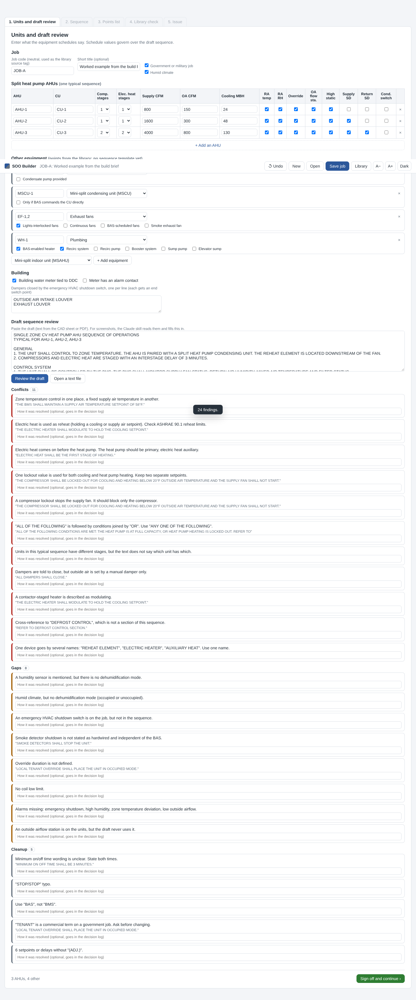
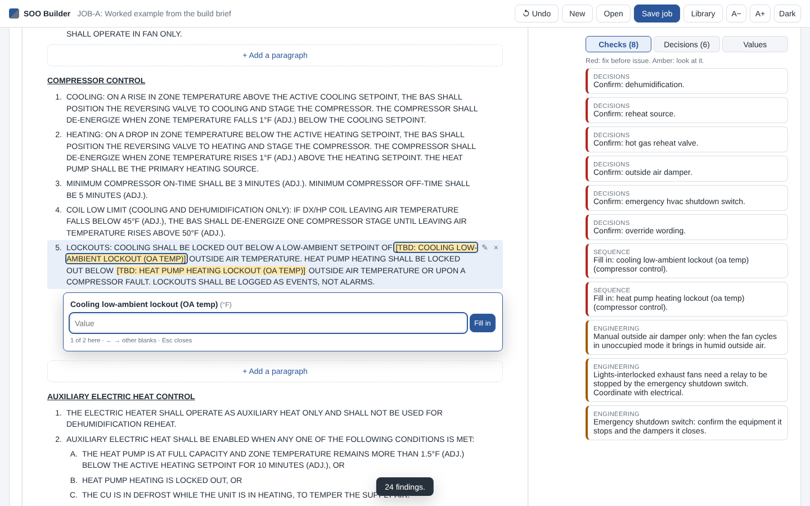
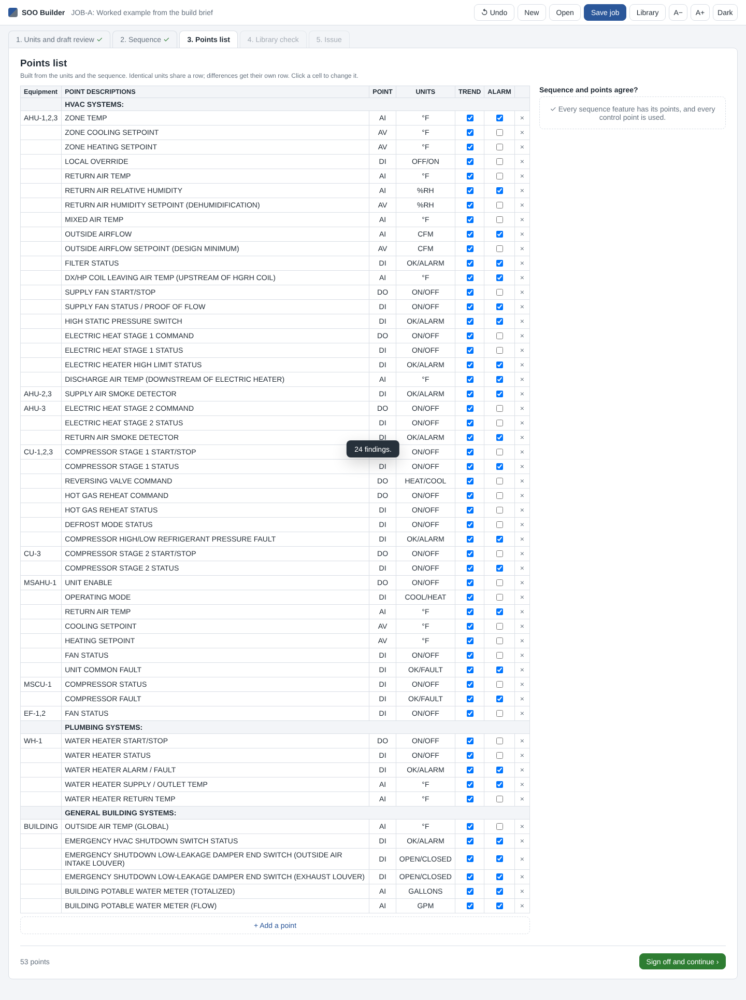
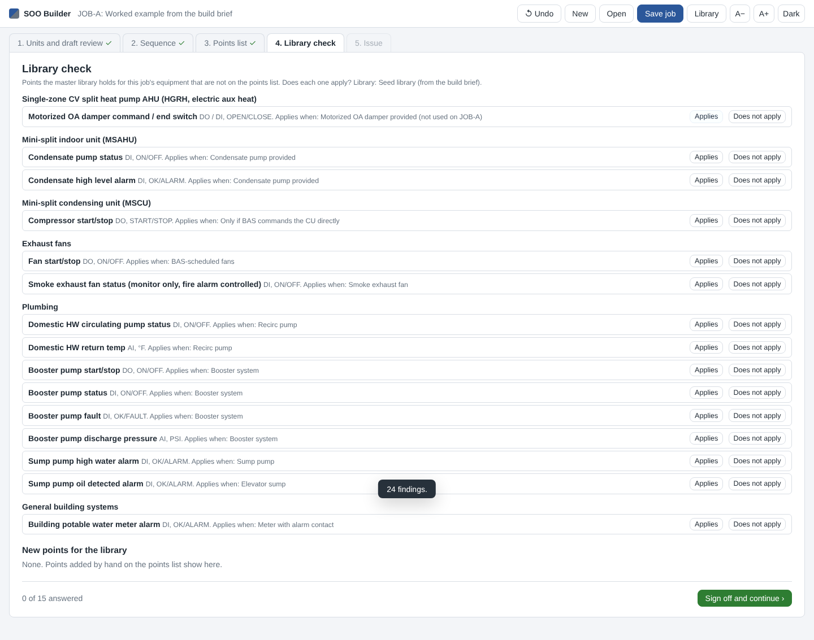
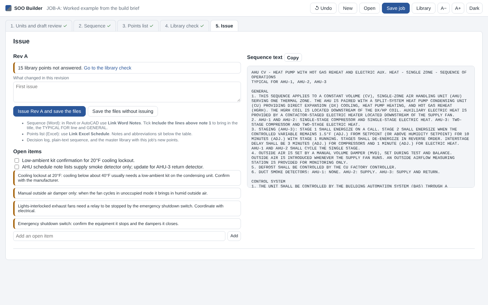

# SOO Builder

Sequence of operations (SOO) and DDC points list builder. It reviews a draft sequence, writes a clean one, builds the points list from the same unit features so the two agree point for point, checks the list against the office master points library, and writes files that CAD Revit Link brings into Revit and AutoCAD.

Two ways to use it, sharing one set of rules:

- **Editor page** (`app/index.html`): opens in Edge or Chrome by double-clicking it. No install, works offline. Copy the `app` folder to the office drive.
- **Claude skill** (`soo-points-builder`): reads screenshots and PDFs of draft sequences, control diagrams and schedules, runs the review, asks the decisions, and writes a job file the editor opens. It can also write the finished files.

## The five stages

Each stage is signed off before the next opens. A change in an earlier stage marks the later stages to look at again.

1. **Units and draft review.** Enter each AHU from the schedule (CU tag, stages, CFM, OA CFM, cooling MBH, sensors, switches, smoke detectors), other equipment from the library, and the building points. Paste the draft sequence and click **Review the draft** for Conflicts, Gaps and Cleanup.
2. **Sequence.** The sequence is written from the split heat pump AHU template as one page. Lit text is a blank to fill: click it, type or pick, and the arrow keys move to the next blank. Double-click a paragraph to write your own wording; it is kept when the units or decisions change, and flagged if the template wording under it changed. **Decisions** lists the multiple-choice calls with the recommended option first. **Values** holds every setpoint and delay (lockouts always asked). **Checks** sits beside the page: red to fix, amber to look at.
3. **Points list.** Built from the units and the decisions. Identical units share a row ("AHU-1,2,3"), differences get their own row ("AHU-3" for stage 2, "AHU-2,3" for the supply smoke detector), condensing unit rows follow their AHUs. Click a cell to change it; removed rows can be put back. The side panel is the cross-check: a sequence feature with no point, or a control point the sequence never uses, or an alarm the condensed sequence leaves to the points list without an Alarm X.
4. **Library check.** Library points for this job's equipment types that are not on the list. Answer **Applies** (switches on the feature or adds the row) or **Does not apply** (logged as "not used on" this job).
5. **Issue.** One revision letter for everything. Issue writes:
   - `<JOB> SEQUENCE OF OPERATIONS REV A.docx`: in Revit or AutoCAD use **Link Word Notes**, and tick **Include the lines above note 1** to bring in the title, the TYPICAL FOR line and GENERAL.
   - `<JOB> DDC POINTS LIST REV A.xlsx`: use **Link Excel Schedule**. Title "Equipment Schedule Points List", medium outer borders, notes and abbreviations below the table, fit to one page wide.
   - `<JOB> SEQUENCE OF OPERATIONS REV A.txt` for copy and paste, `<JOB> DECISION LOG REV A.md`, and `master_points_library.csv` with this job's new points tagged with the job code.

Save the job with **Save job** (Ctrl+S) and open it again with **Open**. Undo (Ctrl+Z) takes back any change. **Library** opens the office copy of the master library CSV; it is remembered on that PC.

## Screens







## Install the Claude skill

```
/plugin install soo-builder --marketplace peterson-engineering/general
```

## Command line

```bash
node cli/build.mjs examples/JOB-A.json --check
```

```bash
node cli/build.mjs examples/JOB-A.json --out "D:/PROJECT/JOB-A/Controls"
```

After editing `library/master_points_library.csv`, rebuild the copy the editor page loads with `node cli/make-data.mjs`. Tests: `node --test tests/engine.test.cjs`.

## What is in the folder

| Folder | Holds |
|---|---|
| `app` | The editor page. `engine.js` holds every rule (sequence template, points mapping, checks, Word and Excel writers) and is shared with the command line and the skill. |
| `library` | Seed master points library and the AHU sequence template from the build brief. |
| `cli` | The command line builder and the library data rebuild. |
| `skills/soo-points-builder` | The Claude skill. |
| `examples` | The worked example (JOB-A) as a job file. |
| `tests` | Acceptance tests from the brief, and a draft sequence written to contain the Appendix C problems. |

## Limits of this first version

- Schematic redlines are not built (left out on purpose for this version).
- Only the single-zone CV split heat pump AHU has a sequence template. Other equipment gets points from the library only.
- The Excel file is written fresh in the template's layout, not filled into a copy of your .xlsx template. Send the office template to check it against.
- The draft review is pattern based. It catches the Section 5.2 problems as they are usually worded; the Claude skill adds a reading for meaning.
- In Excel itself, the long notes run past column F. CAD Revit Link wraps notes at the table width, so the drawn schedule is right. Merging the note cells would stop CAD Revit Link reading them as notes.
- The Appendix C draft in the tests is reconstructed from the brief's list of findings, not the original job's draft.
- Not yet tried in Revit or AutoCAD. The Word and Excel files were opened in LibreOffice and read back; a workstation check with CAD Revit Link is still needed.
